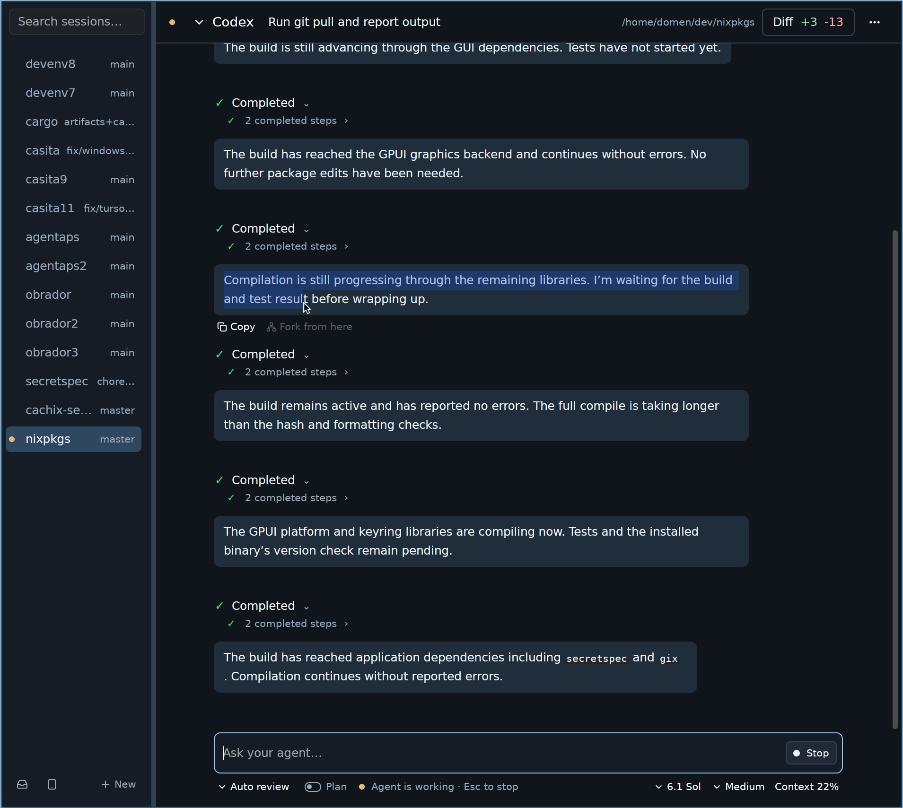

# Agentaps

**A desktop workspace for your coding agents.**

Run agents in local projects or over SSH, keep conversations side by side, review changes, and continue from your phone. Agentaps is built in Rust and speaks the [Agent Client Protocol (ACP)](https://agentclientprotocol.com/get-started/introduction).

[](https://github.com/cachix/agentaps/releases/latest)
[](https://github.com/cachix/agentaps/actions/workflows/checks.yml)
[](https://crates.io/crates/agentaps)
[](LICENSE)

[Download](https://github.com/cachix/agentaps/releases/latest) · [Website](https://agentaps.dev) · [Documentation](https://agentaps.dev/getting-started/) · [Changelog](CHANGELOG.md) · [Report an issue](https://github.com/cachix/agentaps/issues)



## Work in Agentaps

- **Bring your own agent.** Use Codex, Claude Code, Gemini CLI, OpenCode, or another ACP compatible agent. Choose models, reasoning effort, and slash commands when your agent offers them.
- **Keep work organized.** Group sessions by project, queue prompts, search conversations, fork replies, and resume sessions with agents that support it.
- **Work side by side.** Split conversations into resizable panes and restore your layout on restart.
- **Review changes in place.** Inspect local changes in unified or split diffs that refresh as files change.
- **Keep a shell close.** Open a terminal below the composer or start a standalone terminal session on macOS and Linux.
- **Work from another device.** Run agents over SSH or pair a phone browser with your desktop through Web Connect.

## Get started

1. [Download the latest release](https://github.com/cachix/agentaps/releases/latest) for Linux, macOS (Apple Silicon), or Windows. For Ubuntu DEB installation, see [Linux package prerequisites](https://agentaps.dev/terminal/#linux-package-prerequisites). Prefer Cargo? See [Build from source](#build-from-source).
2. Install your agent and its ACP adapter. Agentaps discovers Codex and Claude adapters, Gemini CLI (`gemini --acp`), and OpenCode (`opencode acp`). You can also enter a custom ACP command.
3. Open Agentaps, select **New**, and use **Choose Folder** to open a project. Choose your agent and send a message.

Use **Clone repository…** to start from a Git URL using your installed Git and configured credentials. For a remote project, enter `ssh://user@host/absolute/path`; install the agent and adapter on that host and verify that you can connect with SSH first.

If Codex or Claude Code is installed without its ACP adapter, Agentaps can offer to run the adapter through `npx`. The first run may download it. Agentaps supports ACP v1 and v2 agents.

See the [usage guide](https://agentaps.dev/using-agentaps/) for sessions, split panes, themes, attachments, voice input, and keyboard shortcuts.

## Web Connect

Continue a desktop session from your phone:

1. Select the phone icon in the desktop sidebar to show a pairing QR code.
2. Open [Web Connect](https://agentaps.dev/connect/) on your phone and scan the code, or open the pairing link.
3. Protect the saved connection with a compatible phone passkey or a passphrase of at least 15 characters.

Agent processes and project files stay on your desktop. Keep Agentaps running while connected. Both devices need access to a compatible Iroh relay, and the desktop needs a [SecretSpec](https://secretspec.dev/) provider to store connection credentials. Agentaps prompts you to choose one if needed.

The browser shows the latest 100 messages per session and shortens long messages. Diff review and ACP form questions are currently desktop features. See the [Web Connect guide](https://agentaps.dev/web-connect/) for setup, credential storage, and revoking access.

## Build from source

Install Rust and the [native build dependencies](https://agentaps.dev/build-from-source/), then install the published release:

```sh
cargo install agentaps --locked
```

Or clone the repository and run it with [devenv](https://devenv.sh/), which supplies Rust and the native libraries:

```sh
git clone https://github.com/cachix/agentaps.git
cd agentaps
devenv shell cargo run --release
```

See the [build guide](https://agentaps.dev/build-from-source/) for native dependencies, manual builds, terminal-free installs, and website builds.

## Documentation

Read the [documentation on agentaps.dev](https://agentaps.dev/getting-started/) for setup, [working with agents](https://agentaps.dev/using-agentaps/), the [session terminal](https://agentaps.dev/terminal/), and [Web Connect](https://agentaps.dev/web-connect/).

See [current limitations](https://agentaps.dev/limitations/) for agent compatibility, browser capabilities, and session storage.

## Contributing

Bug reports, documentation improvements, and code contributions are welcome. [Open an issue](https://github.com/cachix/agentaps/issues) with steps to reproduce a problem, your OS, Agentaps version, and agent or adapter command. For feature requests, describe the workflow you want to improve.

Before opening a pull request, read [AGENTS.md](AGENTS.md), run the relevant [CI checks](.github/workflows/checks.yml), and add an entry under **Unreleased** in [CHANGELOG.md](CHANGELOG.md). Maintainer guides cover [web deployment](docs/web-deployment.md) and [releases](docs/releasing.md).

## License

Agentaps is licensed under [Apache-2.0](LICENSE).
